# SUKIMA Bot — アーキテクチャ図

LINE 上で動く日程調整 Bot「SUKIMA Bot」の構成図です。Google Apps Script（GAS）で実装し、LINE Messaging API・Stripe・Gemini API と連携します。

Architecture diagrams of SUKIMA Bot, a LINE scheduling bot built on Google Apps Script, integrated with the LINE Messaging API, Stripe, and the Gemini API.

> ソースコードは非公開です。このリポジトリには図だけを置いています。

## 1. 全体構成
LINE と Stripe からの Webhook を入口で受け、意図解析・日付解釈・空き枠計算・返信までを分担するモジュールの関係です。

## 2. リクエストの流れ
Webhook を受けてから返信するまでの経路です。利用権限の確認、固定コマンド、意図解析、ハンドラ実行、エラー時の代替返信に分かれます。

## 3. 外部サービスとの連携

## 4. データの置き場所
設定・キャッシュ・承認状態・学習ログを、性質に応じて別の保存先に分けています。

## 5. 利用状態の遷移
決済イベントに応じて、未登録 → 申請済み → 利用可 → 失効 と遷移します。

## 図について
- 図のソースは Mermaid です（`diagrams/*.mmd`）。SVG はそこから生成しています。
- 全体構成図は、読みやすさのため共通ユーティリティの記載を省いています。
- 図の無断転載はご遠慮ください。
